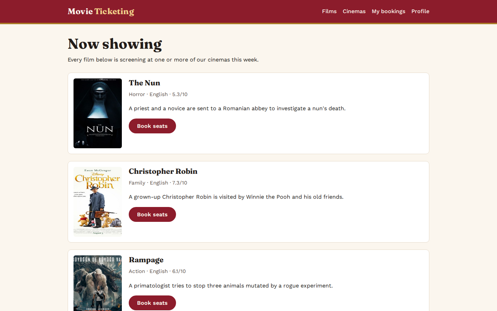
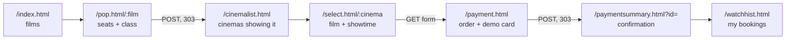
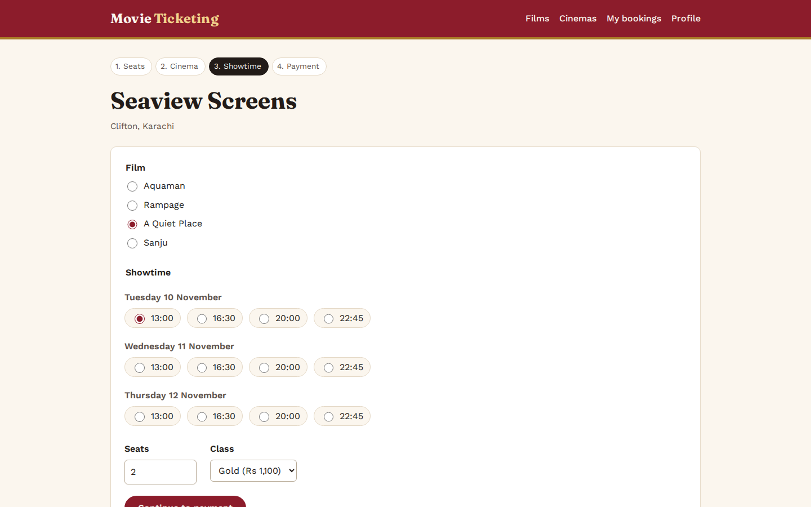
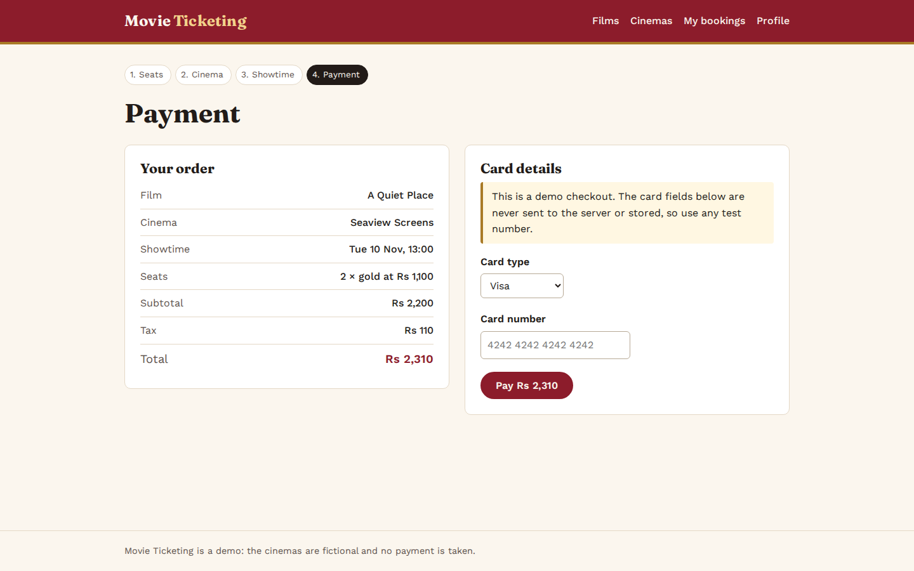
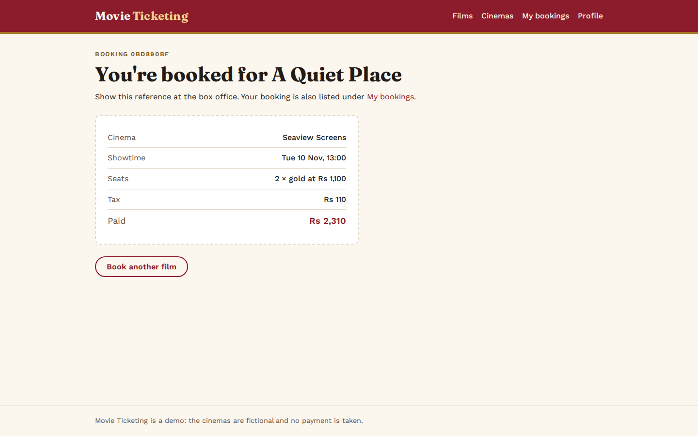
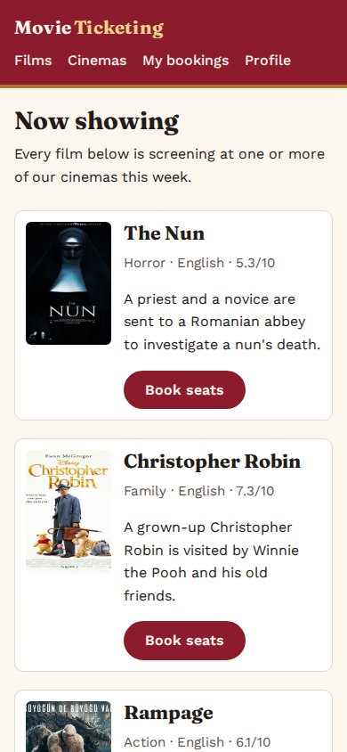
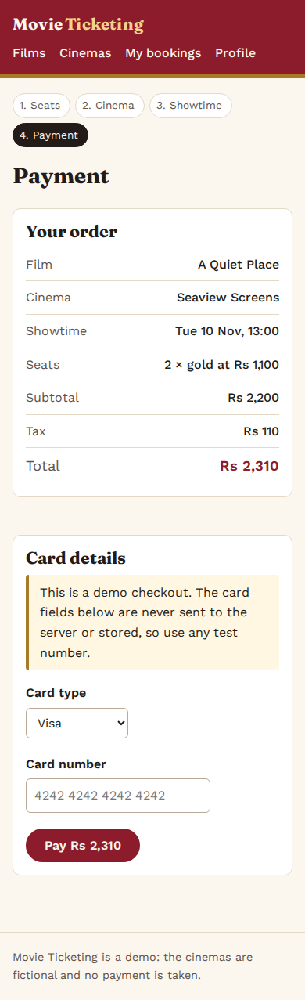
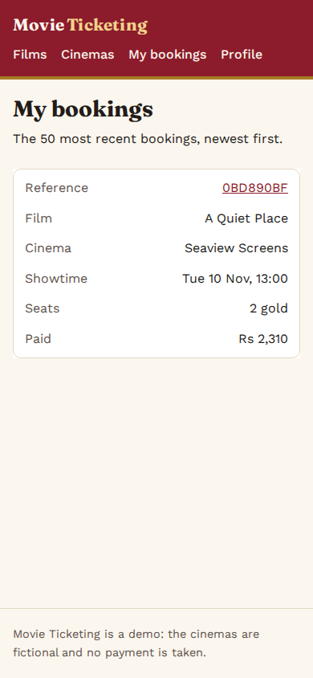

# Movie Ticketing

A small cinema booking site. You pick a film, say how many gold or silver seats you want, choose a cinema that's showing it and a showtime, and pay through a demo checkout. Every booking is stored in MongoDB and listed under "My bookings".

It started as an early student project (a practice clone of a ticketing site). The pages are server-rendered with Express 5 and EJS, and data lives in MongoDB through Mongoose 9. The three cinemas are fictional, and no payment is taken.



## How a booking flows



The choices so far travel to the next page in the query string. Only the last step writes to the database. Before it stores anything, the server re-checks the whole booking:

- the seat count is 1 to 10 and the class is gold or silver
- the cinema is actually showing that film
- the showtime is one of the slots currently on offer
- the price comes from the cinema record. Price fields sent by the browser are ignored.

The card number on the payment page has no `name` attribute, so the browser never sends it.

| Choose a showtime | Pay | Confirmation |
|---|---|---|
|  |  |  |

On a phone the layout collapses to one column, and the bookings table turns into one card per booking:

| Films | Payment | My bookings |
|---|---|---|
|  |  |  |

## Run it with Docker

```bash
docker compose up -d --build
```

This starts MongoDB 7 and the app. Open http://localhost:3700. On first start the app writes a demo catalogue to the empty database: three cinemas in Lahore, Karachi and Islamabad, and seven films. Stop it with `docker compose down` (add `-v` to delete the data too).

## Run it without Docker

You need Node 22 (see `.nvmrc`) and a MongoDB server.

```bash
npm ci
cp .env.example .env    # optional: edit MONGODB_URI / PORT
MONGODB_URI=mongodb://localhost:27017/ticketing npm start
```

The app does not read `.env` itself, so export the variables in your shell or pass them on the command line as above. If `MONGODB_URI` is unset it uses `mongodb://localhost:27017/ticketing`, and the port defaults to 3000. `npm run dev` restarts the app on file changes (`node --watch`).

## Tests and lint

```bash
npm run lint
MONGODB_URI=mongodb://localhost:27017 npm test
```

`npm test` uses the built-in Node test runner. There are 35 tests:

- **Unit tests** for the booking rules: validation, pricing, tax rounding and showtime slots.
- **Source checks**: no connection string in the code carries a password, and only `db.js` opens a connection.
- **Integration tests**: these boot the app on a random port against a throwaway database, which is dropped afterwards. They walk the whole flow, check that browsing never writes to the database, and cover the refusals and 404s.

Without `MONGODB_URI` the integration tests are skipped and the other 17 still run.

## Example requests

These were captured from the Compose stack.

Choosing seats redirects to the cinemas showing that film:

```
$ curl -i -X POST localhost:3700/pop.html/The%20Nun -d 'seats=2&seatClass=gold'
HTTP/1.1 303 See Other
Location: /cinemalist.html?movie=The+Nun&seats=2&seatClass=gold
```

An invalid seat count re-renders the form with a 400:

```
$ curl -i -X POST localhost:3700/pop.html/The%20Nun -d 'seats=12&seatClass=gold'
HTTP/1.1 400 Bad Request
...
<li>Choose between 1 and 10 seats.</li>
```

Confirming a booking stores it and redirects to the confirmation page:

```
$ curl -i -X POST localhost:3700/paymentsummary.html \
    --data-urlencode 'movie=The Nun' --data-urlencode 'cinema=Mall Road Picture House' \
    --data-urlencode 'showtime=2026-11-10T13:00:00.000Z' -d 'seats=2&seatClass=gold'
HTTP/1.1 303 See Other
Location: /paymentsummary.html?id=6af224144e3a4edf42250c15
```

The same booking at a cinema that isn't showing the film is refused:

```
HTTP/1.1 400 Bad Request
...
<li>Seaview Screens isn&#39;t showing The Nun.</li>
```

## Layout

```
app.js                      Express setup, 404 and error handlers, startup
app_server/
  routes/route.js           URL -> controller map
  controllers/              pages, movies, cinemas, bookings
  lib/booking.js            validation, pricing, showtimes (no database)
  lib/format.js             rupees, dates and booking references for views
  models/                   Cinema (with embedded films), Booking, user
  data/catalog.js           demo catalogue seeded on first start
  views/                    EJS pages plus shared partials
public/                     stylesheet, one small script, film thumbnails
tests/                      node:test suites
```

## Design notes

- **The old `.html` URLs are kept.** Links to `/index.html` or `/select.html/...` from the original site still work, and the retired ones redirect.
- **Films are embedded in cinemas.** That matches how the original schema was written. The film list de-duplicates titles across cinemas.
- **Showtimes are generated, not stored.** The schedule is four fixed times a day for the next three days, starting tomorrow, so the demo never shows a stale date. A booking is only accepted for a slot that is still on offer.
- **Prices are in whole rupees.** Tax is 5%, rounded. Each booking stores the unit price, tax and total it was charged, so later price changes don't rewrite past bookings.

## Limitations

- Accounts aren't built. The profile page shows a demo user, and every visitor sees the same booking history.
- Seat capacity isn't tracked, so a showtime can't sell out, and there is no seat map.
- The checkout is a mock-up. No payment provider is involved.
- The film thumbnails are promotional posters for real films, used here as demo content.

## License

MIT. See [LICENSE](LICENSE).
